# 🏛️ PSW Policy Assistant
### Production-Minded Retrieval-Augmented Generation (RAG) Chatbot
*Built with Python, Streamlit, Google Gen AI SDK (Gemini), FAISS, and Local Sentence-Transformers.*

---

## 📌 Executive Overview

The **PSW Policy Assistant** is a document-grounded AI conversational assistant engineered to explore Pakistan Single Window (PSW) official policy documents. 

Rather than relying on generic LLM knowledge or naive full-text stuffing, the application implements a strict **Retrieval-Augmented Generation (RAG)** pipeline:
- **Local Dense Embeddings:** Computes normalized vector embeddings on-device using `sentence-transformers/all-MiniLM-L6-v2`.
- **Vector Search:** Queries an in-memory/persisted **FAISS** index using exact cosine similarity (`IndexFlatIP`).
- **Page-Level Grounding:** Preserves original PDF page numbers throughout ingestion, chunking, and retrieval.
- **Evidence-Bound LLM Generation:** Prompts Google Gemini (`gemini-3.8-flash` via the official `google-genai` SDK) under strict system instructions that mandate abstention when evidence is insufficient and enforce citations to real retrieved chunks.

---

## 🏛️ Knowledge Base & Ingestion Status

The application monitors the four expected policy documents in `data/policies/`:

| Policy Document | Source File | Status | Extraction Details |
| :--- | :--- | :---: | :--- |
| **General Code of Conduct** | `general_code_of_conduct.pdf` | 🟢 **Indexed** | 5 pages, 13,076 characters, 13 chunks |
| **Whistle Blowing Policy** | `whistle_blowing_policy.pdf` | 🟢 **Indexed** | 8 pages, 13,195 characters, 23 chunks |
| **Harassment Policy** | `harassment_policy.pdf` | 🟡 **OCR Required** | 5 pages, 0 extractable characters (photocopier scan) |
| **Anti Corruption Policy** | `anti_corruption_policy.pdf` | 🟡 **OCR Required** | 10 pages, 0 extractable characters (photocopier scan) |

### 🔍 Handling of Scanned Documents
During repository inspection, metadata analysis revealed that `harassment_policy.pdf` and `anti_corruption_policy.pdf` are rasterized image scans produced by a *Konica Minolta bizhub 458e* photocopier without an embedded digital text layer. 

In strict adherence to the project specification (*"If a PDF is scanned and contains no extractable text, report this and explain that OCR would be needed. Do not silently index an empty document"*), the ingestion pipeline detects zero extractable characters, records an actionable diagnostic message, and excludes them from the index so the chatbot does not generate hallucinations.

---

## 📐 Architecture & Data Flow

```mermaid
flowchart TD
    subgraph Ingestion & Indexing
        A["PDF Files (data/policies/)"] --> B["PyMuPDF / pypdf Extraction"]
        B --> C{"Text Extracted?"}
        C -- "Yes (>0 chars)" --> D["Page-Aware Paragraph Chunking"]
        C -- "No (Scanned PDF)" --> E["Flag: Scanned OCR Required (No Empty Chunks)"]
        D --> F["SentenceTransformers Embeddings (all-MiniLM-L6-v2)"]
        F --> G["FAISS IndexFlatIP (data/index/faiss_index.bin)"]
        D --> H["Metadata Mapping (chunks_metadata.json)"]
    end

    subgraph Conversational Query & Grounding
        U["User Inquiry"] --> I["Chat Service (Context Formulation)"]
        I --> J["Query Vector Embedding"]
        J --> K["FAISS Similarity Search (Top-K)"]
        K --> L["Ranked Evidence Passages"]
        L --> M["Grounded Prompt + Quarantine"]
        M --> N["Google Gemini (gemini-3.8-flash)"]
        N --> O["Evidence-Grounded Response + Sources"]
        O --> S["Streamlit UI (Cards & Accordions)"]
    end
```



---

## 🚀 Quickstart & Local Setup

### 1. Prerequisites
- Python 3.10 – 3.13
- Git

### 2. Clone and Setup Environment
```bash
git clone <repository_url>
cd chatbot
```

### 3. Install Dependencies
```bash
pip install -r requirements.txt
```

### 4. Configure Environment
Copy `.env.example` to `.env` and configure your Google Gemini API key:
```ini
GEMINI_API_KEY=your_gemini_api_key_here
GEMINI_MODEL=gemini-3.8-flash
EMBEDDING_MODEL_NAME=sentence-transformers/all-MiniLM-L6-v2
TOP_K=4
```
*(Alternatively, you can input or change your API key directly in the Streamlit application sidebar at runtime).*

### 5. Launch the Application
```bash
python -m streamlit run app.py
```
Open your browser at `http://localhost:8501`.

---

## 🧪 Automated Testing & Evaluation

### Run Test Suite
Run the full 17-test automated test suite (mocked LLM tests run without network access or Gemini quota usage):
```bash
python -m pytest -v tests/
```

### Run RAG Benchmark Evaluation
The benchmark evaluation assesses Hit@K, citation validity, and abstention behavior across factual, scanned, out-of-domain, and adversarial questions:
```bash
# Deterministic retrieval evaluation (Hit@K and ranking)
python evaluation/evaluate.py

# Full end-to-end evaluation including live Gemini generation
python evaluation/evaluate.py --with-llm
```

**Measured Benchmark Results:**
- **Retrieval Hit@4 (Answerable questions):** `100.0%` (6/6)
- **Abstention on Unanswerable / Scanned Queries:** `100.0%` (Honest abstention, zero hallucinated rules)
- **Citation Validity:** `100.0%` (Every cited document and page strictly references retrieved passages)

---

## ☁️ Streamlit Community Cloud Deployment

1. **Repository Push:** Push your repository to GitHub (ensure `.gitignore` excludes `.env` and `secrets.toml`).
2. **New App:** Navigate to [share.streamlit.io](https://share.streamlit.io) and select your repository.
3. **App Settings:** Set Main file path to `app.py`.
4. **Secrets Configuration:** Under **App Settings -> Secrets**, add:
   ```toml
   GEMINI_API_KEY = "your_actual_gemini_api_key"
   GEMINI_MODEL = "gemini-3.8-flash"
   ```
5. **Deploy:** Click **Deploy**. On the first run, Streamlit Cloud will download the lightweight `all-MiniLM-L6-v2` embedding model (~80MB) and build the FAISS index automatically.

> [!NOTE]
> Streamlit Community Cloud provides ephemeral containers. Because the vector store automatically detects missing or stale indexes and builds from the source PDFs in `data/policies/`, the application is completely self-healing on container spin-up.

---

## 🛡️ Limitations & Security Boundary

- **External Data Flow:** While vector search and embeddings run 100% locally on CPU, retrieved policy passages and user questions are sent to the Google Gemini API for natural-language generation.
- **Scanned Document Support:** Image-only PDFs (`Harassment Policy` and `Anti Corruption Policy`) require pre-processing with OCR (Optical Character Recognition) to be indexed. The application provides an optional sidecar interface in `data/ocr_sidecars/{doc_id}.json` to integrate OCR transcriptions when available.
- **Untrusted Content Quarantine:** Retrieved document text is treated as untrusted data and isolated within evidence blocks to prevent indirect prompt injection attacks.
